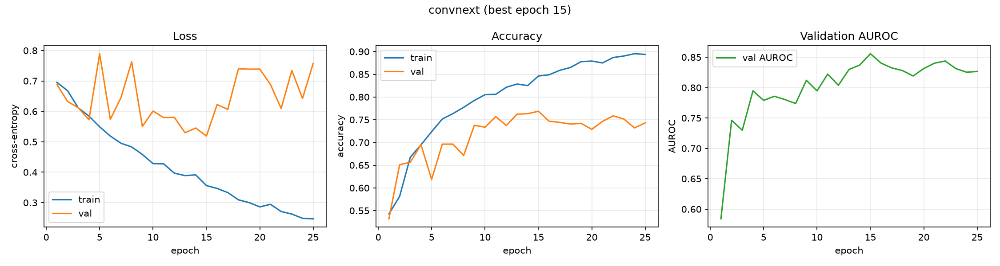
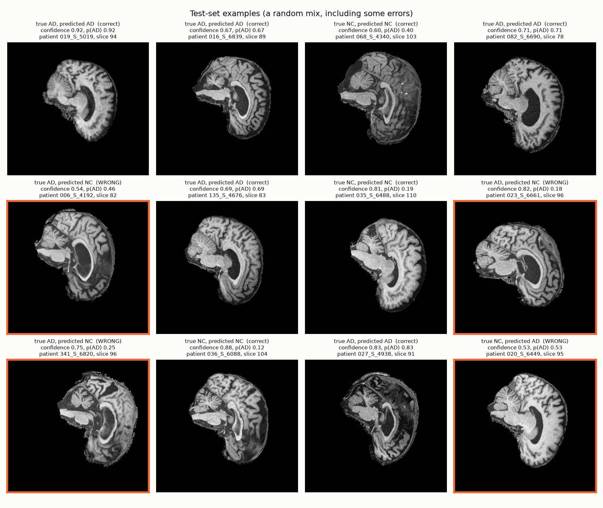
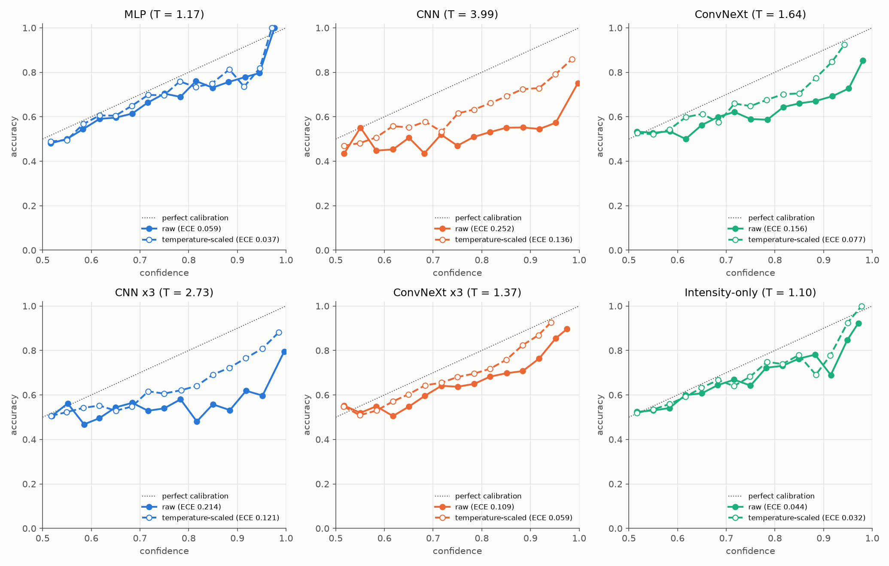
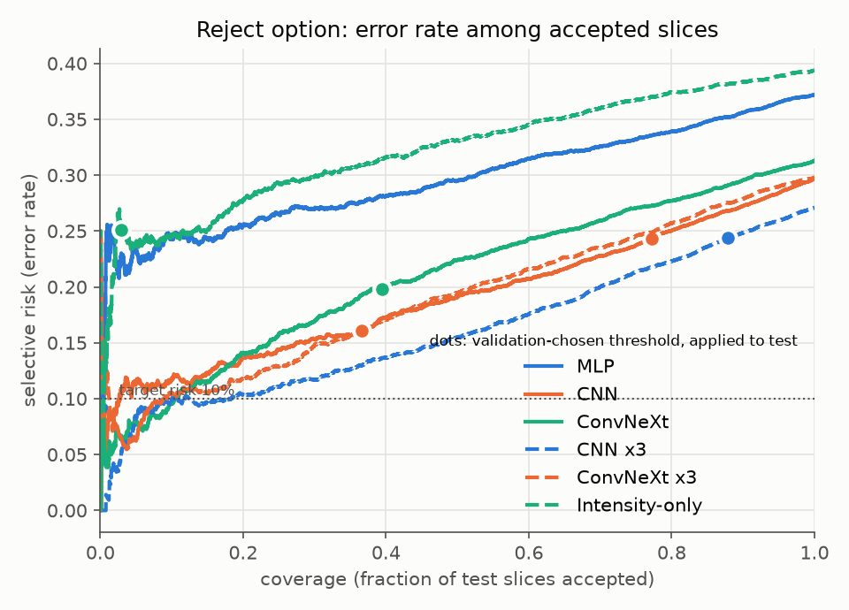
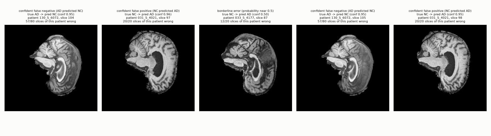

# ConvNeXt for Alzheimer's Disease Classification on ADNI (AD vs NC)

COMP3710/COMP7710 Pattern Recognition, individual project (Hard difficulty). Student: s4929158.

## 1. Overview
**Problem.** Classify 2D slices of T1-weighted brain MRI as Alzheimer's Disease (AD, label 1) or cognitively normal (NC, label 0), using the course copy of ADNI. The engineering question is not only accuracy: does the model's confidence mean anything on ambiguous cases, and can a reject option safely route uncertain cases to a human reviewer?

**Algorithm.** A hand-built, reduced ConvNeXt (Liu et al., 2022) trained from scratch. It keeps ConvNeXt's core design: a patchify stem, 7x7 depthwise convolutions, inverted-bottleneck MLP blocks, LayerNorm, layer scale, stochastic depth and separate downsampling layers. Dimensions (48, 96, 192, 384), depths (2, 2, 6, 2), stochastic-depth rate 0.3, 4,832,018 parameters. No pretrained weights are used. Two baselines are trained on identical splits: an MLP (590,722 parameters) and a small CNN with BatchNorm (1,173,154 parameters).

**How it works.** A 224x224 greyscale slice enters a "patchify" stem (a 4x4 convolution with stride 4, then LayerNorm) that turns the image into a 56x56 grid of 48-dimensional tokens. Four stages of ConvNeXt blocks follow (2, 2, 6 and 2 blocks, with 48, 96, 192 and 384 channels). Each block applies a 7x7 depthwise convolution to mix spatial information, LayerNorm, a 1x1 convolution that expands the channels 4x, a GELU, and a 1x1 convolution that projects back. The result is multiplied by a learnable per-channel layer-scale factor (initialised near zero so each block starts close to the identity) and added to the block's input through a residual connection, with stochastic depth randomly skipping blocks during training to regularise. Between stages, LayerNorm and a 2x2 stride-2 convolution halve the resolution and double the channels. At the end, global average pooling, LayerNorm, dropout (0.2) and a linear layer give two logits, trained with cross-entropy. The softmax of the logits is the model's confidence, which Section 6 evaluates and calibrates with temperature scaling.

**Headline result (clean, patient-level split; per slice, official test folder).** ConvNeXt reaches **0.693 +/- 0.005 test accuracy** and AUROC 0.762 +/- 0.010 over three training seeds. This is below the 0.80 Hard-tier target. The CNN baseline is as accurate (0.703 +/- 0.025) and has a higher AUROC (0.796 +/- 0.009). ConvNeXt is better calibrated and more sensitive to AD. The aggregate accuracy also hides a data problem: in the training folder every AD scan was acquired in 2011 to 2013 and every NC scan in 2017 to 2021, so a rule that looks only at the acquisition year scores 0.733 on the test set. Inside the 2019 to 2021 test scans, where the year cannot give the answer away, ConvNeXt reaches an AUROC of 0.682 and AD recall of 0.51. Details and caveats are in Sections 5 and 6.

**Figures.** Training curves: `runs/convnext_v2_dp/curves.png` (also `runs/cnn_auroc/curves.png`, `runs/mlp_auroc/curves.png`). Example predictions: `predictions/convnext_v2_dp/predictions_grid.png`.





## 2. Feasibility review
**1. User need, scope and acceptance criteria.**
*User:* a clinical reviewer who wants an assistant that auto-classifies clear cases and routes uncertain ones to an expert. *Prototype:* 2D slice-level AD vs NC classifier with calibrated confidence and a reject option; not a diagnostic tool. *Acceptance criteria (testable):*
1. Test accuracy of ConvNeXt >= 0.80 (per slice) on the official test folder, with no subject in more than one split.
2. ConvNeXt compared with the MLP and CNN baselines on identical splits, reporting per-class precision/recall, macro-F1 and AUROC.
3. Calibration reported (ECE, Brier, NLL), with temperature fitted on validation only. Target: ECE <= 0.10 after scaling.
4. A reject threshold chosen on validation that gives accepted-case accuracy of at least 90% at coverage of at least 30% on test.
5. Resource constraint: peak GPU memory and inference latency profiled. Target: trains and runs on one A100 at batch 64, with batch-1 latency <= 10 ms per image.

**2. Model choice and course concepts.** Dataset: ADNI 2D slices (train 21,520 slices / 1,076 scans; test 9,000 slices / 450 scans; 20 slices per scan). Model: ConvNeXt (Hard band), chosen because it modernises a plain CNN with transformer-era design choices while staying convolutional, so it trains from scratch on a small medical dataset. Course concepts used: CNNs and normalisation, regularisation (weight decay, stochastic depth, augmentation), optimisation (AdamW, warmup + cosine), evaluation beyond accuracy (calibration, ROC), and failure analysis. Reference: Liu et al., "A ConvNet for the 2020s", CVPR 2022.

**3. Preliminary feasibility evidence.**
- *Data audit* (`python dataset.py --audit`): file names carry a scan ID, not a patient ID. Using `meta_data_with_label.json`, 1,526 scans map to 680 subjects (1-8 scans each). 216 subjects appear in both the official train and test folders (5,560 of 9,000 test slices, 61.8%). My first random scan-level split leaked 71.4% of validation slices.
- *Consequence:* validation accuracy was inflated (CNN 0.96 validation vs 0.74 test). I switched to a subject-level split and remove the 216 shared subjects from training only (official test folder untouched). Final clean split: train 10,820 slices, validation 1,880 slices (85 subjects), test 9,000 slices.
- *First results:* on the clean split ConvNeXt reaches 0.687 and the CNN 0.704 test accuracy (single runs), so the 0.80 target is not met. On a leaky split that keeps the shared subjects (train 18,100 slices) the same models reach 0.737 and 0.757, which shows how much leakage and extra data inflate the numbers (Section 5.4).

**4. Risks, budget and fallback.**
- *Risks:* (a) ConvNeXt may stay below 0.80 on the clean split because training data shrinks (this happened); (b) slices of one scan are highly correlated, so 2D slice accuracy can overstate real performance; (c) queue delays on Rangpur.
- *Budget:* one A100, 1 job per user, 12 h QOS limit. Each final model trains in 4 to 7 minutes (Section 6.3); the tuning study of about 20 runs fitted comfortably in the budget.
- *Next experiment:* tune ConvNeXt (drop path, weight decay, augmentation, size, EMA) using validation only, then report seeds, confidence intervals and the failure analysis.
- *Fallback:* if still below 0.80, report the honest result with the failure analysis, and with tutor/Ed approval consider pooling all subjects into my own subject-level split. Optional extra: GFNet comparison only after the main analysis is solid.

## 3. Dependencies and reproducibility
Python 3.11.13 with matplotlib 3.11.2, numpy 2.4.6, pillow 12.3.0, scikit-learn 1.9.1, scipy 1.17.1, torch 2.5.1+cu121 and torchvision 0.20.1+cu121.

Run on Rangpur (venv at `~/venvs/comp3710`). Final models:
```bash
python dataset.py --audit                                   # data audit and split report
TAG=auroc EXTRA="--select-metric auroc" sbatch train.sbatch mlp          # runs/mlp_auroc
TAG=auroc EXTRA="--select-metric auroc" sbatch train.sbatch cnn          # runs/cnn_auroc  (seeds: --seed 1/2, TAG=auroc_s1/auroc_s2)
TAG=v2_dp EXTRA="--select-metric auroc --drop-path 0.3" sbatch train.sbatch convnext   # runs/convnext_v2_dp (seeds: --seed 1/2, TAG=v2_dp_s1/v2_dp_s2)
python evaluate.py --runs runs/mlp_auroc runs/cnn_auroc runs/convnext_v2_dp \
  --names MLP CNN ConvNeXt --focus ConvNeXt \
  --ensemble "CNN x3" runs/cnn_auroc runs/cnn_auroc_s1 runs/cnn_auroc_s2 \
  --ensemble "ConvNeXt x3" runs/convnext_v2_dp runs/convnext_v2_dp_s1 runs/convnext_v2_dp_s2 \
  --intensity-baseline --bootstrap 1000                     # writes analysis/summary.md and figures
python predict.py --checkpoint runs/convnext_v2_dp/best.pt --temperature 1.64   # example inference and figures
```
Seeds: split seed 42 (fixed), training seeds 0, 1, 2 (`--seed`: initial weights, shuffling, augmentation). Model selection uses validation AUROC only (never the test set). `modules.py` imports only `torch` and `torch.nn`. Checkpoints (`*.pt`) and per-slice prediction CSVs are not committed.

## 4. Data and pre-processing
- Images resized to 224x224, single channel, normalised. Training augmentation is mild (small affine transform and brightness/contrast jitter, no flips, to avoid changing laterality). A horizontal flip, mixup and a stronger augmentation recipe were tested as ablations (Section 5.5).
- **Splits:** subject-level, stratified by each subject's majority label. 15% of training subjects (85 subjects, 1,880 slices) are held out for validation. `assert_no_leakage` checks that no subject is in two splits. The 216 subjects shared by the official train and test folders are removed from training only (8,820 slices), leaving 10,820 training slices. The official test folder (9,000 slices, 331 patients) is untouched and used once, at the end, with the checkpoint chosen on validation.
- Justification: slices and scans from one subject are near-duplicates, so a random split lets the model memorise people instead of learning disease features. The effect is quantified in Section 5.4.
- Using `meta_data_with_label.json`, I found that each prefix maps to a raw file name that contains an ADNI subject ID and ends in the same number as the prefix (for example prefix `1221051` maps to `ADNI_002_S_0413_..._I1221051.nii`, so the prefix is the ADNI image ID of one scan), and that one subject has 1 to 8 scans with different prefixes. Under that mapping 216 of the 680 subjects appear in both folders: subject `002_S_0413` has scan 863056 in train and scan 1221051 in test, and subject `002_S_1261` has scans 831065 and 989320 in train and scan 1270020 in test. Both settings are reported: the clean split (shared subjects removed from training; the main result) and the as-provided folders with shared subjects kept (Section 5.4, labelled "leaky" there because the shared subjects mean the test patients were also seen in training).
- Label and acquisition-year confound: the raw file names in the metadata carry a timestamp that I take to be the acquisition date (ADNI naming). Counting scans by that year and label gives the table below. In the training folder the year separates the classes perfectly, so a model can learn scan era (scanner or protocol appearance) instead of disease. The test folder breaks the pattern: all 227 NC scans are from 2019 to 2021, but so are about 88 of the AD scans, and every AD scan from 2017 onwards is in the test folder only. No split of the training folder can remove this, because training contains no AD scans from the later era. Section 5.3 measures its effect.

| Acquisition year | 2011 | 2012 | 2013 | 2014 | 2015 | 2017 | 2018 | 2019 | 2020 | 2021 |
|---|---|---|---|---|---|---|---|---|---|---|
| Train scans (AD share) | 57 (1.00) | 253 (1.00) | 210 (1.00) | 0 | 0 | 153 (0.00) | 292 (0.00) | 89 (0.00) | 17 (0.00) | 5 (0.00) |
| Test scans (AD share) | 0 | 0 | 54 (1.00) | 45 (1.00) | 4 (1.00) | 5 (1.00) | 28 (1.00) | 147 (0.33) | 133 (0.20) | 34 (0.35) |

- Reporting: all accuracies are per slice (each image counted separately). Patient-level accuracy is a supplementary figure only: it needs an extra aggregation rule that the task does not specify, and I use the mean of a patient's slice probabilities, thresholded at 0.5.

## 5. Results
All numbers are on the official test folder, clean split, per slice, unless labelled otherwise.

### 5.1 Main comparison (single runs, seed 0)

| Model | Accuracy | Balanced acc. | Macro-F1 | AUROC | AD precision | AD recall | NC precision | NC recall | Patient-level acc. (suppl.) |
|---|---|---|---|---|---|---|---|---|---|
| MLP | 0.628 | 0.627 | 0.621 | 0.686 | 0.669 | 0.493 | 0.604 | 0.760 | 0.665 |
| CNN | 0.704 | 0.702 | 0.696 | 0.797 | 0.789 | 0.548 | 0.659 | 0.856 | 0.761 |
| ConvNeXt | 0.687 | 0.687 | 0.686 | 0.753 | 0.702 | 0.641 | 0.675 | 0.732 | 0.701 |

NC precision is computed from the confusion matrices (rows true, columns predicted): MLP NC->NC 3452, NC->AD 1088, AD->NC 2259, AD->AD 2201; CNN 3887, 653, 2015, 2445; ConvNeXt 3324, 1216, 1601, 2859.

### 5.2 Seed variability, ensembles, confidence intervals

Mean +/- sample std over three training seeds (the MLP was run once):

| Model | Accuracy | AUROC |
|---|---|---|
| CNN (3 seeds) | 0.703 +/- 0.025 | 0.796 +/- 0.009 |
| ConvNeXt (3 seeds) | 0.693 +/- 0.005 | 0.762 +/- 0.010 |

Patient-level bootstrap (1,000 resamples of the 331 test patients; whole patients are resampled because errors cluster by patient), 95% intervals, and the logit-average ensembles of the three seeds. "Intensity-only" is a logistic regression on three global image statistics (mean intensity, contrast, foreground fraction), fitted on the training slices.

| Model | Accuracy [95% CI] | AUROC [95% CI] |
|---|---|---|
| MLP | 0.628 [0.587, 0.673] | 0.686 [0.633, 0.742] |
| CNN | 0.704 [0.661, 0.749] | 0.797 [0.749, 0.841] |
| ConvNeXt | 0.687 [0.652, 0.723] | 0.753 [0.709, 0.795] |
| CNN x3 ensemble | 0.729 [0.686, 0.772] | 0.806 [0.758, 0.850] |
| ConvNeXt x3 ensemble | 0.702 [0.668, 0.737] | 0.773 [0.730, 0.815] |
| Intensity-only | 0.606 [0.570, 0.642] | 0.665 [0.620, 0.709] |

Paired differences against single ConvNeXt (model minus ConvNeXt, same resamples; p-values are uncorrected for multiple comparisons and p < 0.001 means below about 0.002):

| Model | Delta accuracy [95% CI] | p | Delta AUROC [95% CI] | p |
|---|---|---|---|---|
| MLP | -0.059 [-0.089, -0.029] | < 0.001 | -0.067 [-0.099, -0.035] | < 0.001 |
| CNN | +0.017 [-0.019, +0.053] | 0.31 | +0.044 [+0.014, +0.075] | 0.004 |
| CNN x3 | +0.043 [+0.010, +0.073] | 0.010 | +0.054 [+0.024, +0.084] | 0.002 |
| ConvNeXt x3 | +0.015 [+0.003, +0.027] | 0.010 | +0.020 [+0.008, +0.031] | < 0.001 |
| Intensity-only | -0.081 [-0.119, -0.045] | < 0.001 | -0.088 [-0.129, -0.047] | < 0.001 |

Reading: the best model (CNN x3, 0.729, upper CI 0.772) does not reach 0.80. The CNN and ConvNeXt are tied on accuracy within noise, but the CNN has a significantly higher AUROC (also visible in the seed means). The bootstrap reflects which test patients were drawn; the seed std reflects training randomness. Ensembling gives small but consistent gains. Three global image statistics already give 0.606 accuracy, so some of the models' score is reachable without anatomy; ConvNeXt adds about 8 points over that.

## 5.3 Where the errors are

- Error rate by slice index is flat, about 0.26 to 0.37 for every slice index from 78 to 114 (`analysis/slice_error.png`, ConvNeXt). No slice position is clearly informative or uninformative.
- 2,817 of 9,000 test slices are misclassified by ConvNeXt, spread over 237 of 331 patients. 103 patients have at least half their slices wrong, and they account for 70.9% of all errors.
- Share of ConvNeXt's errors that other models also make: MLP 69.6% (chance level, from that model's own error rate: about 37%), CNN 57.9% (about 30%), intensity-only 60.0% (about 39%). Errors are strongly shared across models, well above chance.
- Patient-level accuracy (0.701) is close to slice accuracy (0.687): averaging a patient's slices does not fix a patient the model gets wrong.

**Acquisition-era shortcut.** Because the training classes differ perfectly in acquisition year (Section 4), I checked how much of the test score the year alone explains.
- A rule that assigns AD to scans up to 2016 and NC to later scans (derived from the training folder alone) scores 0.733 per test slice (0.624 if 2014 to 2016 are assigned to NC). The models score 0.628 to 0.757 (Section 5.1 and 5.4), so their aggregate accuracy is about what the year alone gives.
- A fairer check uses only the 2019 to 2021 test scans (6,280 slices, 72% NC), where both classes exist and the year cannot give the answer away:

| Model | Accuracy | AUROC | AD recall | NC recall | AD recall on AD scans before 2019 |
|---|---|---|---|---|---|
| MLP, clean | 0.667 | 0.628 | 0.422 | 0.760 | 0.539 |
| CNN, clean | 0.691 | 0.667 | 0.261 | 0.856 | 0.732 |
| ConvNeXt, clean | 0.671 | 0.682 | 0.510 | 0.732 | 0.725 |
| MLP, leaky | 0.652 | 0.645 | 0.459 | 0.726 | 0.664 |
| CNN, leaky | 0.735 | 0.744 | 0.210 | 0.937 | 0.808 |
| ConvNeXt, leaky | 0.739 | 0.717 | 0.287 | 0.912 | 0.734 |

- Always predicting NC would score 0.72 on these slices, so the clean models do not beat that trivial rule on accuracy there, and the leaky CNN and ConvNeXt barely do. Their AUROC inside the era (0.63 to 0.74) is the measure of signal that the year cannot explain, and it is modest.
- Every model finds far fewer AD cases among 2019 to 2021 scans than among earlier AD scans (CNN 0.26 against 0.73, ConvNeXt 0.51 against 0.73). This is what an era shortcut predicts, since all training scans from that era are NC. ConvNeXt is affected less than the CNN. Differences between models inside the era were not tested for significance.

## 5.4 Effect of the data leak

"Leaky" keeps the 216 subjects shared by the official train and test folders in training (train 18,100 slices, validation 3,420; train/validation are still separated by subject). It is a different and more favourable setup, and also uses 67% more training data, so the table cannot separate "more data" from "leakage". Single seed (0) on both sides; do not use leaky numbers as results.

| Model | Clean acc / AUROC | Leaky acc / AUROC | Delta acc | Delta AUROC |
|---|---|---|---|---|
| MLP | 0.628 / 0.686 | 0.655 / 0.716 | +0.027 | +0.030 |
| CNN | 0.704 / 0.797 | 0.757 / 0.864 | +0.053 | +0.067 |
| ConvNeXt | 0.687 / 0.753 | 0.737 / 0.826 | +0.050 | +0.073 |

The CNN beats ConvNeXt in both settings. Within the leaky setup, ConvNeXt with a horizontal flip scored 0.684 / 0.801 and with mixup (alpha 0.2) 0.714 / 0.784 (test loss 0.608 against 1.065 for the baseline), so neither helped accuracy or AUROC in these single runs.

**Shared versus unseen test subjects.** The official test folder holds 331 subjects. 216 of them (5,560 slices) also have scans in the official training folder ("shared"); the other 115 (3,440 slices) do not ("unseen"). Test accuracy / AUROC for each group, single runs:

| Run | Shared subjects (5,560 slices) | Unseen subjects (3,440 slices) | All 9,000 slices |
|---|---|---|---|
| MLP, clean | 0.694 / 0.752 | 0.522 / 0.648 | 0.628 / 0.686 |
| CNN, clean | 0.856 / 0.938 | 0.456 / 0.643 | 0.704 / 0.797 |
| ConvNeXt, clean | 0.743 / 0.833 | 0.597 / 0.688 | 0.687 / 0.753 |
| MLP, leaky | 0.731 / 0.810 | 0.533 / 0.629 | 0.655 / 0.716 |
| CNN, leaky | 0.956 / 0.992 | 0.437 / 0.692 | 0.757 / 0.864 |
| ConvNeXt, leaky | 0.892 / 0.951 | 0.487 / 0.720 | 0.737 / 0.826 |

- On the leaky models the score is carried by the shared subjects (0.89 to 0.96) while accuracy on unseen subjects is at or below chance (0.44 to 0.49, with AUROC 0.69 to 0.72, so the models still rank cases somewhat but their threshold is wrong for new subjects).
- A matched comparison separates memorisation from the rest. The clean models never saw the shared subjects, so leaky minus clean on the shared subjects is the effect of having a subject's other visits in training: +0.037 (MLP), +0.100 (CNN), +0.149 (ConvNeXt). On unseen subjects the same difference is +0.011, -0.019 and -0.110. These are single runs, so differences of a few points are within noise.
- The clean models also score much higher on the shared group than on the unseen group (for example CNN 0.856 against 0.456), although neither group was seen in training. So the two groups differ in difficulty for reasons other than memorisation, and the raw shared-versus-unseen gap should not be read as memorisation alone. The groups differ in class mix and era: the shared subjects are 278 scans with an AD share of 0.37 and a mean acquisition year of 2017.4, the unseen subjects are 172 scans with an AD share of 0.69 and a mean year of 2019.3. Unseen subjects are therefore mostly AD scans from the later era, which is where the year shortcut of Section 5.3 fails.
- Acquisition years (from the raw file names, scans): training 2011 to 2013 (520) and 2017 to 2018 (445), with 111 from 2019 to 2021; test mostly 2019 to 2020 (280 of 450 scans, 62%). ConvNeXt (clean) accuracy by test scan year is not monotonic: 0.77 (2013), 0.83 (2014), 0.44 (2015, 4 scans), 0.57 (2017, 5 scans), 0.54 (2018), 0.68 (2019), 0.69 (2020), 0.55 (2021). Several years have very few scans, so this shows a possible time shift but does not establish it.

### 5.5 Tuning and negative results (clean split, ConvNeXt, single seed)

Every configuration tried is listed (no cherry-picking). Selection used validation AUROC at the selected epoch only; test numbers are shown for transparency. Differences below about 0.01 validation AUROC are within the noise of an 85-subject validation set (per-epoch swings of up to 0.05).

| Run | Change from the base recipe | Val AUROC | Test acc | Test AUROC |
|---|---|---|---|---|
| v1 | drop path 0.1 | 0.839 | 0.692 | 0.768 |
| **v2 (final)** | **drop path 0.3** | **0.856** | **0.687** | **0.753** |
| v3 | + weight decay 0.1, lr 2e-4 | 0.829 | 0.680 | 0.756 |
| v4, v6, v7 | stronger augmentation (with variants) | training collapsed | about 0.50 | n/a |
| v5 | small model (1.90M parameters) | 0.830 | 0.666 | 0.769 |
| v10 | + horizontal flip | 0.846 | 0.681 | 0.785 |
| v11 | + mixup 0.2 | 0.844 | 0.631 | 0.691 |
| v12 | large model (27.8M parameters) | 0.855 | 0.617 | 0.769 |
| v13 | + EMA 0.999 | 0.845 | 0.671 | 0.756 |
| v14 | smoothed epoch selection (3 epochs) | 0.840 | 0.646 | 0.763 |
| v15 | EMA 0.998 + smoothed selection | 0.845 | 0.671 | 0.756 |

No variant beat v2 on validation by more than the noise level, so v2 was kept. Model size, augmentation, EMA and smoothing all land in the same band, which suggests that data (about 600 training subjects after removing the overlap) limits performance more than the architecture. The strong-augmentation runs failed to train (training accuracy stayed near 0.55); the cause was not investigated. The EMA runs make the validation curve smooth and settle near 0.845, suggesting that the true validation AUROC of the base recipe is about 0.84 to 0.85 and that v2's 0.856 is partly a lucky epoch. Because several configurations were compared on one small validation set, the selection carries a multiple-comparisons caveat.


## 6. Open research dilemma

### 6.1 Benchmarking against the baselines

See Sections 5.1 and 5.2. ConvNeXt (0.693 +/- 0.005 accuracy, 0.762 +/- 0.010 AUROC) clearly beats the MLP (0.628 / 0.686) and the intensity-only baseline (0.606 / 0.665), ties the CNN on accuracy, and trails the CNN on AUROC (0.796 +/- 0.009). Per class, ConvNeXt finds more AD cases (recall 0.641 against 0.548 for the CNN) at the cost of more false alarms (NC recall 0.732 against 0.856). The CNN is more specific; which one is preferable depends on the relative cost of missed AD and false alarms. A likely reason is that both models are mostly picking up coarse, global appearance cues (overall intensity and scan style) rather than fine anatomy, and a small BatchNorm CNN with a quarter of the parameters can learn such cues as easily as ConvNeXt; this is a hypothesis I did not test, though the intensity-only baseline (0.606 accuracy) shows that simple global statistics already carry some signal.

### 6.2 Calibration and reject option

Temperature T is fitted on validation logits only and applied to test.

| Model | T | ECE raw | ECE scaled | NLL raw | NLL scaled | Brier |
|---|---|---|---|---|---|---|
| MLP | 1.17 | 0.059 | 0.037 | 0.656 | 0.648 | 0.230 |
| CNN | 3.99 | 0.252 | 0.136 | 2.021 | 0.686 | 0.265 |
| ConvNeXt | 1.64 | 0.156 | 0.077 | 0.728 | 0.614 | 0.231 |
| CNN x3 | 2.73 | 0.214 | 0.121 | 1.316 | 0.636 | 0.234 |
| ConvNeXt x3 | 1.37 | 0.109 | 0.059 | 0.627 | 0.583 | 0.208 |
| Intensity-only | 1.10 | 0.044 | 0.032 | 0.668 | 0.664 | 0.236 |

The CNN is strongly overconfident (T = 3.99). ConvNeXt is better calibrated before and after scaling, and the ConvNeXt ensemble is best (ECE 0.059, NLL 0.583, Brier 0.208). ECE alone is misleading: the intensity-only model has the lowest ECE because a weak, never-confident model is easy to calibrate, so NLL, Brier and AUROC must be read alongside it. ConvNeXt meets calibration target 3 (ECE <= 0.10 after scaling).



Reject option: the threshold on calibrated confidence is chosen on validation so that the error among accepted slices is at most 10%, then applied to test.

| Model | Threshold | Test coverage | Test error among accepted | Error at 80% coverage | AURC |
|---|---|---|---|---|---|
| MLP | 0.927 | 0.2% | 9.1% | 33.9% | 0.296 |
| CNN | 0.716 | 77.2% | 24.3% | 25.0% | 0.191 |
| ConvNeXt | 0.830 | 39.4% | 19.8% | 27.7% | 0.209 |
| CNN x3 | 0.629 | 87.9% | 24.4% | 22.3% | 0.161 |
| ConvNeXt x3 | 0.834 | 36.6% | 16.1% | 25.7% | 0.190 |
| Intensity-only | 0.878 | 2.9% | 25.1% | 37.4% | 0.322 |



No model meets acceptance criterion 4 (at least 90% accuracy among accepted slices at 30% coverage or more): the best, ConvNeXt x3, has 16.1% error at 36.6% coverage. The validation-chosen threshold does not transfer to test, because the validation set is easier (about 0.76 validation accuracy against 0.69 on test) and confidence barely separates right from wrong: ConvNeXt's mean calibrated confidence is 0.784 on correct and 0.719 on incorrect test slices (`predictions/convnext_v2_dp/confidence_hist.png`). A reject option tuned on a small validation set therefore gives a false sense of safety under this distribution shift.

### 6.3 Resource profiling

| Model | Parameters | Peak train VRAM (MB) | Latency (ms/img, batch 1) | Throughput (img/s, batch 64) | Train time (min) | Best epoch |
|---|---|---|---|---|---|---|
| MLP | 590,722 | 40 | 0.16 | 388,134 | 4.9 | 28 |
| CNN | 1,173,154 | 2,017 | 1.02 | 5,149 | 6.8 | 32 |
| ConvNeXt | 4,832,018 | 1,885 | 5.55 | 5,291 | 4.2 | 15 |
| CNN x3 | 3,519,462 | 2,017 | 3.17 | 1,718 | 16.2 | mixed |
| ConvNeXt x3 | 14,496,054 | 1,885 | 17.54 | 1,756 | 10.8 | mixed |

Throughput is the model forward pass on a batch of 64 and excludes data loading. Ensemble rows add the members' parameters, latency and training time. The ConvNeXt is about 5 times slower than the CNN per image at batch 1 (many small layers) but equal at batch 64. Every single model meets resource criterion 5 (one A100, batch-1 latency of at most 10 ms; ConvNeXt 5.55 ms). The three-member ConvNeXt ensemble does not (17.54 ms).

### 6.4 Failure-case autopsies

Selected automatically from ConvNeXt's test errors (`analysis/failure_cases.png`, `analysis/failure_cases.csv`). Reference statistics are the mean +/- std over correctly classified test slices: NC mean intensity 0.123 +/- 0.020, contrast 0.233 +/- 0.029, foreground fraction 0.255 +/- 0.023; AD 0.110 +/- 0.019, 0.214 +/- 0.031, 0.250 +/- 0.025.



| # | Case | Conf. | Patient, slice | Patient's wrong slices | Mean intensity / contrast / foreground |
|---|---|---|---|---|---|
| 1 | confident false negative (AD predicted NC) | 0.95 | 130_S_6072, 104 | 57/80 | 0.125 / 0.240 / 0.248 |
| 2 | confident false positive (NC predicted AD) | 0.96 | 031_S_4021, 97 | 20/20 | 0.144 / 0.254 / 0.285 |
| 3 | borderline error (probability near 0.5) | 0.50 | 033_S_4177, 87 | 12/20 | 0.115 / 0.210 / 0.283 |
| 4 | confident false negative (AD predicted NC) | 0.95 | 130_S_6072, 105 | 57/80 | 0.121 / 0.233 / 0.247 |
| 5 | confident false positive (NC predicted AD) | 0.95 | 031_S_4021, 98 | 20/20 | 0.150 / 0.264 / 0.286 |

Observations:
Looking at `failure_cases.png`, the five cases come from three patients (cases 1 and 4 are adjacent slices of one scan, and so are cases 2 and 5). The AD scans of 130_S_6072 are darker, softer and lower in contrast than the others, so they look unlike the sharp scans the model saw for NC. The NC scans of 031_S_4021 are bright and sharp with an enlarged ventricle and widened sulci, so the model’s AD call plausibly follows real anatomy that the NC label does not reflect. The NC scan of 033_S_4177 is grainy with a noisy brain edge, which looks like an acquisition or processing artefact and fits its borderline probability of 0.50. In all three cases the appearance of the scan, not just disease, seems to drive the prediction. I judged this by eye and did not test it.
- Cases 1 and 4 are adjacent slices of the same patient, as are cases 2 and 5, so there are only three distinct patients. Each patient is wrong on most of their slices (57/80 and 20/20), so these are patient-level failures, not isolated slices. This fits Section 5.3: 103 patients account for 70.9% of errors.
- Patient 130_S_6072 (cases 1 and 4, AD) has four scans from 2017 to 2019, an era in which every training scan is NC, and only 29% of this patient's slices are classified correctly. This fits the acquisition-era shortcut of Section 5.3: the scan date looks like an NC scan. In the images these scans are darker, softer and lower in contrast than the other cases, with a hazy grey band around the cortex, and the mean intensity of case 1 is close to the NC average (0.125 against 0.123 for NC and 0.110 for AD).
- Patient 031_S_4021 (cases 2 and 5, NC) has a single scan from 2019 and every one of its 20 slices is predicted AD with about 0.95 confidence. The era shortcut would predict NC for a 2019 scan, so it does not explain this error. The slices are brighter and sharper than typical NC slices (mean intensity 0.144 to 0.150 against 0.123 +/- 0.020) with a larger foreground fraction, and the images show an enlarged lateral ventricle and widened sulci. To my eye this looks atrophic, so the AD prediction may follow real anatomy that the NC label does not reflect. I judged this by eye and did not test it.
- Case 3 (patient 033_S_4177, NC, 2020) is a genuinely ambiguous slice (confidence 0.50) of a patient who is wrong on 12 of 20 slices, the kind of case a reject option should catch. The image is grainy with a speckled, jagged brain edge, which looks like an acquisition or processing artefact.
- Because confidence barely separates right from wrong (Section 6.2), confident errors like cases 1, 2, 4 and 5 cannot be caught by a confidence threshold.
- Intensity statistics distinguish the classes only partially (the means differ by less than one standard deviation), so these three numbers are only weak evidence.

### 6.5 Recommendation to the project manager
- **Do not advance this model as a classifier.** Per-slice accuracy is about 0.69 (95% CI 0.65 to 0.72), well below the 0.80 target; the best system tried (a three-CNN ensemble) reaches 0.729 (upper CI 0.772).
- **The data, not the architecture, is the main problem.** In the training folder, acquisition year separates AD from NC perfectly, and a year-only rule scores 0.733 on the test set, about what the models score. Inside the 2019 to 2021 test scans, where the year cannot decide, the models' accuracy (0.67 to 0.69 for the clean ones) is no better than always predicting NC (0.72), and their AUROC is 0.63 to 0.68. A headline accuracy near 0.7 therefore says little about whether the models detect Alzheimer's disease.
- **ConvNeXt's extra cost is not clearly justified.** On the full test set the CNN baseline is as accurate and has a higher AUROC with about a quarter of the parameters. ConvNeXt is better calibrated (single model) and misses fewer AD cases (recall 0.641 against 0.548). Inside the 2019 to 2021 test scans it has the highest AUROC of the clean models (0.682 against 0.667 for the CNN and 0.628 for the MLP; not tested for significance) and far higher AD recall (0.51 against 0.26), so it leans less on the era cue. If one model had to be chosen, the choice depends on how costly a missed AD case is.
- **Do not deploy the reject option as tuned.** Confidence barely separates right from wrong, and no validation-tuned threshold reached the 10% error target on test (best 16.1% at 36.6% coverage). A reject option would need patient-level confidence and a larger, more representative validation set.
- **Evaluate per patient, not per slice.** Errors cluster by patient (103 of 331 patients account for 70.9% of errors) and slices from one patient are correlated, so slice-level accuracy overstates how many independent cases were tested. Use patient-level splits and confidence intervals.
- **Caveats.** The official train and test folders share 216 subjects, which inflates results if not removed; results here are on the cleaned split. The validation set is small (85 subjects), and several configurations were compared on it. Single seeds were used for most ablations.
- **Next steps if the project continued:** training data in which AD and NC scans come from the same era and scanners (no choice of model or split can fix the current confound), more subjects, evaluation reported separately by acquisition era, and checking why some NC scans from the later era (for example patient 031_S_4021) are confidently called AD.

## 7. Artificial Intelligence Usage Disclosure
- **Tools:** Claude (Anthropic) used as a coding and writing assistant.
- **Tasks:** scaffolding `dataset.py`, `modules.py`, `train.py`, `evaluate.py`, `predict.py` and the Slurm script; debugging Rangpur/Slurm issues; suggesting experiments and statistical analysis (patient-level bootstrap, ensembles, baselines); drafting this README structure and the tables from the generated outputs.
- **Verification:** I personally reviewed every line of the code I submitted, conducted the data audit and examined subject overlap myself, reran the experiments and verified the logs, cross-checked the metrics against the raw logs, reviewed the failure-case images, and independently wrote the interpretation and recommendations.

## 8. References
1. Z. Liu, H. Mao, C.-Y. Wu, C. Feichtenhofer, T. Darrell, S. Xie, "A ConvNet for the 2020s", CVPR 2022.
2. C. Guo, G. Pleiss, Y. Sun, K. Q. Weinberger, "On Calibration of Modern Neural Networks", ICML 2017 (temperature scaling).
3. I. Loshchilov, F. Hutter, "Decoupled Weight Decay Regularization", ICLR 2019 (AdamW).
4. G. Huang, Y. Sun, Z. Liu, D. Sedra, K. Q. Weinberger, "Deep Networks with Stochastic Depth", ECCV 2016.
5. H. Zhang, M. Cisse, Y. Dauphin, D. Lopez-Paz, "mixup: Beyond Empirical Risk Minimization", ICLR 2018.
6. Alzheimer's Disease Neuroimaging Initiative (ADNI), adni.loni.usc.edu, via the course copy.
